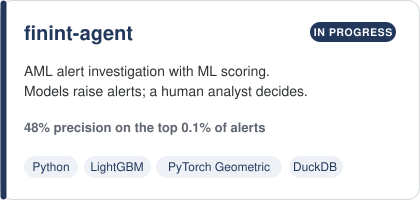
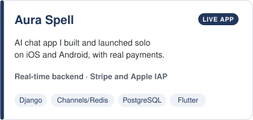

# Filipe Paço

**Software Engineer** · Python backends and ML systems for regulated finance · Brazil

I build systems that people rely on: Python and Django services, data pipelines and ML models, shipped with tests, CI and audit trails from day one. I have 4+ years of professional software engineering, most of it in banking and other regulated environments, and I use AI tools every day across the whole development cycle.

[LinkedIn](https://www.linkedin.com/in/filipe-pa%C3%A7o-926233237/) · [Aura Spell](https://auraspell.app/?lang=en)

## Projects

<table>
  <tr>
    <td></td>
    <td></td>
  </tr>
  <tr>
    <td></td>
    <td></td>
  </tr>
</table>

### Currently building: finint-agent

A model scores transactions and raises alerts sized to the analyst team's capacity. For each alert, read-only tools gather evidence, screen parties against the OFAC sanctions list and draft a grounded case file. Deterministic code enforces grounding and policy, a human analyst makes the final decision, and every step lands in a hash-chained audit log.

## What I've shipped

- **Credit-analysis service at a cooperative bank.** A Python/Django service integrated into the core credit platform through REST APIs, used daily by credit analysts, with an LLM step that classifies risk and checks compliance. It cut process time by **37%** and analysts' data entry by **62%**. I also wrote internal libraries that other teams adopted and a monitoring service the team uses every day.
- **Assessment platform at a university AI center**, as technical lead of a 3-person team: output validation, an on-premise deployment on a restricted network and an end-to-end fine-tuned model (**~70% faster turnaround**, **~40% fewer invalid outputs**).
- **RoadBox AI**, from zero to production with a 7-person team: smart-camera ingestion, real-time detection in PyTorch and OpenCV, backend uploads, statistics and heatmaps.
- **AI-native SDLC at a financial-services client** (current): automating development workflows and measuring delivery with DORA metrics.

## Stack

- **Backend:** Python · Django · Django REST Framework · FastAPI · PostgreSQL · Redis · Kafka · REST APIs
- **Data and ML:** DuckDB · pandas · scikit-learn · LightGBM · PyTorch · PyTorch Geometric · OpenCV
- **AI:** LangGraph · RAG · fine-tuning and evaluation · LiteLLM · MCP · Gemini · Azure OpenAI · Whisper
- **Delivery:** Docker · GitHub Actions · AWS · pytest · mypy · spec-driven development with Claude Code

## Education and certifications

B.Sc. in Software Engineering, Federal University of Goiás (UFG) · Databricks Certified Generative AI Engineer Associate · Claude Certified Architect – Foundations · Portuguese (native), English (C1)
